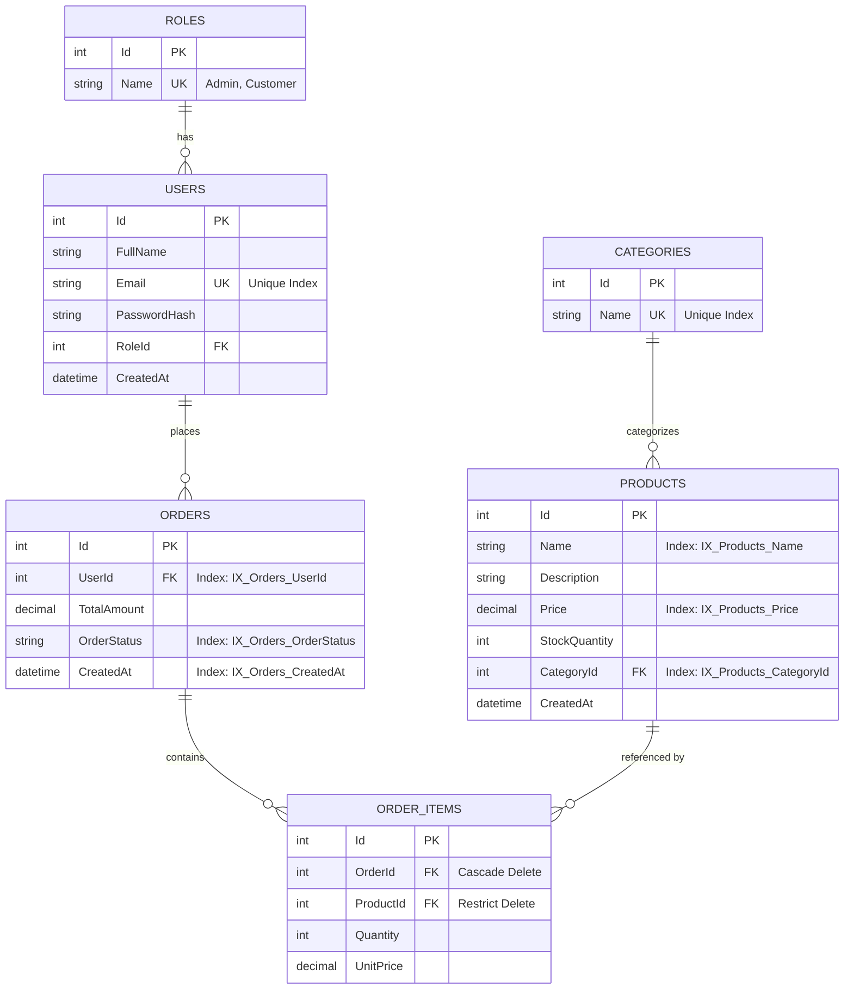

# 🛍️ ShopSphere – Enterprise Full-Stack E-Commerce Platform

[](https://dotnet.microsoft.com/)
[](https://react.dev/)
[](https://vitejs.dev/)
[](https://learn.microsoft.com/ef/core/)
[](https://www.microsoft.com/sql-server)
[](https://redis.io/)
[](https://github.com/jbogard/MediatR)
[](https://getbootstrap.com/)
[-success?style=for-the-badge)](https://xunit.net/)

**ShopSphere** is a production-ready, full-stack E-Commerce platform built from scratch adhering to **Clean Architecture**, **Domain-Driven Design (DDD)**, and the **CQRS (Command Query Responsibility Segregation)** pattern. It features dual frontend interfaces (**React + Vite SPA** and **ASP.NET Core MVC**), high-speed distributed caching via **Redis**, robust authentication with **JWT & BCrypt**, database indexing for multi-attribute product queries, and ACID transactional order processing with real-time inventory deduction.

---

## 📑 Table of Contents
- [Architecture & Design Principles](#-architecture--design-principles)
- [System Architecture Diagram](#-system-architecture-diagram)
- [Repository Structure](#-repository-structure)
- [Tech Stack](#-tech-stack)
- [Key Features](#-key-features)
- [Database Schema & Indexing](#-database-schema--indexing)
- [REST API Endpoints](#-rest-api-endpoints)
- [Getting Started & Local Setup](#-getting-started--local-setup)
- [Demo Credentials](#-demo-credentials)
- [Automated Unit Testing](#-automated-unit-testing)
- [Troubleshooting & FAQ](#-troubleshooting--faq)
- [License](#-license)

---

## 🏛️ Architecture & Design Principles

ShopSphere is structured according to the **Clean Architecture** (Onion Architecture) paradigm and strictly follows **SOLID** principles:

1. **Domain Layer (`ShopSphere.Domain`):** Pure enterprise logic with **Rich Domain Models** (encapsulated state, business invariants, and domain exceptions). Zero external third-party dependencies.
2. **Application Layer (`ShopSphere.Application`):** Implements **CQRS** via MediatR. Contains query handlers, command handlers, pipeline behaviors (`ValidationBehavior`, `CachingBehavior`), DTOs, and FluentValidation rules.
3. **Infrastructure Layer (`ShopSphere.Infrastructure`):** Implements external concerns including EF Core 8 mappings, SQL Server migrations, Generic Repository & Unit of Work, Redis distributed caching, BCrypt password hashing, and HMAC-SHA256 JWT generation.
4. **Presentation Layer (`ShopSphere.Web` & `frontend/`):** 
   - **Backend API & MVC:** ASP.NET Core REST API (`/api/v1/*`), Swagger UI, Global Error Middleware, and server-rendered MVC views.
   - **Modern Client (SPA):** High-speed React 18 + Vite frontend with responsive Bootstrap 5, Lucide icons, and Axios request interceptors.

---

## 📊 System Architecture Diagram

```mermaid
graph TD
    subgraph Client Layer
        ReactApp["React 18 + Vite SPA (Port 3000)"]
        MVCApp["ASP.NET Core MVC Views (Port 5243)"]
        Swagger["Swagger UI (/swagger)"]
    end

    subgraph Presentation & Gateway
        API["ASP.NET Core Web API (Port 5243)"]
        CORS["CORS Policy Middleware"]
        AuthMiddleware["JWT Bearer & Cookie Auth"]
        ErrorMiddleware["Global Exception Handler"]
    end

    subgraph Application Layer - CQRS
        MediatR["MediatR Pipeline"]
        ValBehavior["ValidationBehavior (FluentValidation)"]
        CacheBehavior["CachingBehavior (Redis Interceptor)"]
        Commands["Commands (Checkout, AddToCart, ProductCRUD)"]
        Queries["Queries (GetProducts, GetOrders, GetCart)"]
    end

    subgraph Infrastructure & Persistence
        UoW["Unit of Work (ACID Transactions)"]
        Repos["ProductRepo / OrderRepo / GenericRepo"]
        EFCore["Entity Framework Core 8"]
        SqlServer[("SQL Server: ShopSphereDb")]
        RedisCache[("Redis Cache: Cart & Product Queries")]
    end

    Client Layer --> CORS --> API
    API --> ErrorMiddleware --> AuthMiddleware --> MediatR
    MediatR --> ValBehavior --> CacheBehavior
    CacheBehavior -. Cache Hit .-> RedisCache
    CacheBehavior -. Cache Miss .-> Queries & Commands
    Commands & Queries --> UoW --> Repos --> EFCore --> SqlServer
```

---

## 📁 Repository Structure

```text
ShopSphere/
├── ShopSphere.sln
│
├── src/
│   ├── ShopSphere.Domain/              # Pure Domain Layer
│   │   ├── Common/                     # BaseEntity (Id, CreatedAt, UpdatedAt)
│   │   ├── Entities/                   # Product, Order, OrderItem, Category, User, Role
│   │   ├── Enums/                      # OrderStatus (Pending, Processing, Shipped, Delivered, Cancelled)
│   │   ├── Exceptions/                 # DomainException
│   │   └── Interfaces/                 # IRepository<T>, IProductRepository, IOrderRepository, IUnitOfWork
│   │
│   ├── ShopSphere.Application/         # CQRS Business Logic
│   │   ├── Common/
│   │   │   ├── Behaviors/              # ValidationBehavior, CachingBehavior
│   │   │   ├── Exceptions/             # ValidationException, NotFoundException, BadRequestException
│   │   │   ├── Interfaces/             # IApplicationDbContext, ICacheService, IJwtTokenGenerator, etc.
│   │   │   └── Models/                 # ApiResponse<T>, PagedResult<T>
│   │   ├── Features/
│   │   │   ├── Auth/                   # Login/Register Commands & Services
│   │   │   ├── Cart/                   # Redis Cart Commands (AddToCart, Update, Remove, Clear) & Queries
│   │   │   ├── Orders/                 # CheckoutOrderCommand (Atomic transaction), Status updater, Queries
│   │   │   └── Products/               # Product CRUD, Filtered queries, FluentValidators
│   │   └── DependencyInjection.cs      # MediatR and FluentValidation registration
│   │
│   ├── ShopSphere.Infrastructure/      # External Concerns
│   │   ├── Data/
│   │   │   ├── Configurations/         # EF Core Fluent API & Index Configurations
│   │   │   ├── Migrations/             # Code-First Migrations (InitialCreate)
│   │   │   ├── ApplicationDbContext.cs # EF Core DbContext with Auto-Auditing Timestamps
│   │   │   └── DbInitializer.cs        # Seed default Admin and Customer accounts
│   │   ├── Repositories/               # GenericRepository, ProductRepository, OrderRepository, UnitOfWork
│   │   ├── Services/                   # AuthService, CacheService (Redis), JwtTokenGenerator, PasswordHasher
│   │   └── DependencyInjection.cs      # SQL Server, Redis, JWT & Repositories registration
│   │
│   └── ShopSphere.Web/                 # Web API & MVC Presentation
│       ├── Controllers/
│       │   ├── Api/                    # REST APIs (AuthController, ProductsController, CartController, etc.)
│       │   ├── AccountController.cs    # MVC Auth Controller
│       │   ├── AdminController.cs      # MVC Admin Dashboard
│       │   ├── CartController.cs       # MVC Shopping Cart
│       │   ├── HomeController.cs       # MVC Storefront Controller
│       │   └── OrdersController.cs     # MVC Orders Controller
│       ├── Middleware/                 # ExceptionHandlingMiddleware
│       ├── Views/                      # Bootstrap 5 MVC Views
│       ├── appsettings.json            # Database & Redis Connection Strings, JWT Secrets
│       └── Program.cs                  # Host configuration, JWT Bearer, CORS & Swagger
│
├── frontend/                           # Dedicated Modern React Frontend
│   ├── src/
│   │   ├── api/client.js               # Axios HTTP client with JWT interceptor & baseURL
│   │   ├── context/                    # AuthContext (JWT/User State), CartContext (Redis sync)
│   │   ├── components/                 # Navbar, Footer, ProductCard, ProtectedRoute
│   │   ├── pages/                      # HomePage, CartPage, CheckoutPage, OrdersPage, AdminDashboard, Auth
│   │   ├── App.jsx                     # Client routing
│   │   └── main.jsx                    # Application root
│   ├── package.json
│   └── vite.config.js                  # Vite server config (Port 3000, API proxy)
│
└── tests/
    └── ShopSphere.UnitTests/           # Automated Test Suite (xUnit, Moq, FluentAssertions)
        ├── Domain/                     # ProductDomainTests, OrderDomainTests
        └── Features/                   # GetProductsQueryHandlerTests, CheckoutOrderCommandHandlerTests, AddToCartTests
```

---

## 🛠️ Tech Stack

### Backend
- **Framework:** C# / .NET 8.0 LTS
- **Architecture:** Clean Architecture + CQRS + DDD
- **Mediator Pattern:** MediatR 12.4.1
- **Validation:** FluentValidation 11.10.0
- **Database & ORM:** Microsoft SQL Server 2022 / LocalDB, Entity Framework Core 8.0.10
- **Distributed Caching:** Redis (via `StackExchange.Redis` 2.8 & `Microsoft.Extensions.Caching.StackExchangeRedis`) with automatic resilient memory cache fallback
- **Authentication & Security:** JWT Bearer (HMAC-SHA256) + BCrypt.Net-Next (work factor 11)
- **API Documentation:** Swagger / OpenAPI (Swashbuckle 6.9)

### Frontend
- **SPA Framework:** React 18 + Vite
- **Styling & Icons:** Bootstrap 5.3 + Bootstrap Icons + Lucide React
- **HTTP Client:** Axios (automatic request/response interceptors)
- **Routing:** React Router v6
- **Server-Rendered MVC Alternative:** ASP.NET Core Razor Views with Bootstrap 5

### Testing
- **Test Runner:** xUnit 2.8
- **Mocking:** Moq 4.20
- **Assertions:** FluentAssertions 6.12
- **In-Memory DB:** Microsoft.EntityFrameworkCore.InMemory 8.0.10

---

## 🌟 Key Features

### 1. User Authentication & Role-Based Access Control (RBAC)
- **BCrypt Password Security:** Passwords hashed with salt factor 11 before persistence.
- **JWT Authorization:** Tokens pack user claims (`UserId`, `FullName`, `Email`, `Role`, `Jti`).
- **Flexible Token Consumption:** Accepts tokens through HTTP `Authorization: Bearer <token>` headers or secure HTTP-only cookies.
- **Role Permissions:**
  - `Admin`: Full management of products, inventory stock adjustments, and order fulfillment states.
  - `Customer`: Catalog search, filtering, Redis cart actions, transactional checkout, and order history tracking.

### 2. Product Catalog & Multi-Attribute Filtering
- **Dynamic Attribute Search:** Filter seamlessly by keyword, category, and price range bounds ($Min - $Max).
- **Composite Index Performance:** Leverages SQL Server composite index `IX_Products_CategoryId_Price` to deliver sub-millisecond query responses.
- **Pagination:** Clean `PagedResult<T>` with page counts, navigation flags (`HasNextPage`, `HasPreviousPage`), and configurable page sizes.
- **Automatic Query Caching:** MediatR `CachingBehavior` transparently caches filtered query results in Redis for 5 minutes.

### 3. Shopping Cart via Redis Distributed Caching
- **Sub-Millisecond Cart Operations:** Items added, updated, and removed directly from Redis (`cart:{cartKey}`) without relational DB overhead.
- **7-Day Sliding Expiration:** Preserves customer carts across browsing sessions.
- **Stock Threshold Checks:** Validates requested quantities against available stock in real-time.
- **Resilient Fallback:** Automatically degrades to in-memory distributed cache if a local Redis daemon is unreachable.

### 4. Atomic Checkout & Real-Time Inventory Deduction
- **ACID Transaction Boundary:** Executed via `IUnitOfWork.BeginTransactionAsync()` and `CommitTransactionAsync()`.
- **Domain Invariant Enforcement:** Calls `product.DeductStock(quantity)`; if any item is out of stock, the transaction safely rolls back.
- **Cart Invalidation:** Atomically clears the Redis cart upon transaction commit.

### 5. Order Tracking & Restocking Workflow
- **Visual Status Progression:** Interactive progress indicator displaying `Pending` $\rightarrow$ `Processing` $\rightarrow$ `Shipped` $\rightarrow$ `Delivered`.
- **Order Cancellation:** Customers and Admins can cancel non-delivered orders; cancelled quantities are automatically restocked back to the product inventory.

### 6. Admin Management Dashboard
- **Key Health Metrics:** Total Catalog Items, Low-Stock Alerts ($< 10$ units), Total Customer Orders, and Platform Revenue.
- **Catalog CRUD:** Modal/form workflows to create, update, restock, and delete products.
- **Order Fulfillment:** Live status dropdown updater to move orders through the fulfillment pipeline.

---

## 🗄️ Database Schema & Indexing

The schema was generated using EF Core Code-First migrations and is deployed to SQL Server (**`ShopSphereDb`**):



### High-Performance Database Indexes
- `IX_Products_CategoryId`: Single index for category filtering.
- `IX_Products_Price`: Single index for price filtering and sorting.
- `IX_Products_CategoryId_Price`: **Composite Index** for category + price range queries.
- `IX_Products_Name`: Index for text search acceleration.
- `IX_Users_Email`: Unique index for credential lookups.
- `IX_Orders_UserId` & `IX_Orders_CreatedAt`: Covering order history queries.

---

## 📡 REST API Endpoints

All endpoints are prefixed with `/api/v1` and documentable via Swagger UI at `/swagger`:

### 🔐 Authentication (`/api/v1/auth`)
| Method | Endpoint | Description | Auth Level |
| :--- | :--- | :--- | :--- |
| `POST` | `/api/v1/auth/register` | Register new account and receive JWT | Public |
| `POST` | `/api/v1/auth/login` | Authenticate credentials and receive JWT | Public |
| `GET` | `/api/v1/auth/me` | Retrieve current authenticated user context | `[Authorize]` |

### 📦 Product Catalog (`/api/v1/products`)
| Method | Endpoint | Description | Auth Level |
| :--- | :--- | :--- | :--- |
| `GET` | `/api/v1/products` | Multi-attribute search, category/price filter & pagination | Public |
| `GET` | `/api/v1/products/{id}` | Get product details by ID | Public |
| `POST` | `/api/v1/products` | Create a new product | `[Authorize(Roles="Admin")]` |
| `PUT` | `/api/v1/products/{id}` | Update product specifications and inventory | `[Authorize(Roles="Admin")]` |
| `DELETE` | `/api/v1/products/{id}` | Delete product from catalog | `[Authorize(Roles="Admin")]` |
| `GET` | `/api/v1/categories` | Get cached distinct category list | Public |

### 🛒 Shopping Cart (`/api/v1/cart`)
| Method | Endpoint | Description | Auth Level |
| :--- | :--- | :--- | :--- |
| `GET` | `/api/v1/cart` | Get current user / session cart from Redis | Public / Authorized |
| `POST` | `/api/v1/cart/items` | Add product to cart with stock validation | Public / Authorized |
| `PUT` | `/api/v1/cart/items` | Update quantity of a cart item | Public / Authorized |
| `DELETE` | `/api/v1/cart/items/{id}`| Remove specific item from cart | Public / Authorized |
| `DELETE` | `/api/v1/cart` | Clear entire shopping cart in Redis | Public / Authorized |

### 🧾 Orders & Fulfillment (`/api/v1/orders`)
| Method | Endpoint | Description | Auth Level |
| :--- | :--- | :--- | :--- |
| `POST` | `/api/v1/orders/checkout` | Atomic checkout, inventory deduction & cart clear | `[Authorize]` |
| `GET` | `/api/v1/orders/my-orders` | Retrieve authenticated user's order history | `[Authorize]` |
| `GET` | `/api/v1/orders/{id}` | Get detailed order status and items | `[Authorize]` |
| `GET` | `/api/v1/orders` | Retrieve all customer orders | `[Authorize(Roles="Admin")]` |
| `PUT` | `/api/v1/orders/{id}/status`| Update order fulfillment status | `[Authorize(Roles="Admin")]` |
| `POST` | `/api/v1/orders/{id}/cancel`| Cancel order and restock inventory | `[Authorize]` |

---

## 🚀 Getting Started & Local Setup

### Prerequisites
- [.NET 8.0 SDK](https://dotnet.microsoft.com/download/dotnet/8.0) or higher
- [Node.js](https://nodejs.org/) (v18+) & `npm`
- [SQL Server](https://www.microsoft.com/sql-server) or LocalDB (default: `(localdb)\mssqllocaldb`)
- *(Optional)* [Redis](https://redis.io/) running on port `6379` *(automatic in-memory fallback enabled if offline)*

---

### Step 1: Clone Repository
```bash
git clone https://github.com/harshalsonar-dev/ShopSphere.git
cd ShopSphere
```

---

### Step 2: Run Backend API (.NET 8)
Open a terminal in the project root:
```bash
dotnet run --project src/ShopSphere.Web/ShopSphere.Web.csproj
```
- **Backend Port:** `http://localhost:5243`
- **Swagger Documentation:** [http://localhost:5243/swagger](http://localhost:5243/swagger)
- **MVC Storefront:** [http://localhost:5243](http://localhost:5243)

*(Database migrations and demo accounts are automatically applied on startup!)*

---

### Step 3: Run Modern React Frontend (Vite)
Open a second terminal window:
```bash
cd frontend
npm install
npm run dev
```
- **React Frontend:** Open **[http://localhost:3000](http://localhost:3000)** in your browser!

---

## 🔑 Demo Credentials

The database is seeded with two ready-to-test accounts. Both the React SPA and MVC interfaces feature **one-click auto-fill buttons** on the sign-in page:

| Role | Email | Password | Permissions |
| :--- | :--- | :--- | :--- |
| **Admin** | `admin@shopsphere.com` | `Admin@123` | Full access to Admin Dashboard, Product Inventory CRUD, Low Stock Alerts, and Order Status Management |
| **Customer** | `customer@shopsphere.com` | `Customer@123` | Browse catalog, filter products, Redis cart, transactional checkout, and order tracking |

---

## 🧪 Automated Unit Testing

The test project `ShopSphere.UnitTests` uses **xUnit**, **Moq**, and **FluentAssertions** to ensure domain invariants and CQRS pipelines function reliably:

```bash
dotnet test tests/ShopSphere.UnitTests/ShopSphere.UnitTests.csproj
```

### Test Suite Summary:
```text
Test run for ShopSphere.UnitTests.dll (.NETCoreApp,Version=v8.0)
Total tests: 14. Passed: 14. Failed: 0. Skipped: 0.
Duration: 160 ms (100% Pass Rate)
```
- **Product Domain Tests:** Stock deduction, threshold boundaries, restocking, detail updates, domain exception triggers.
- **Order Domain Tests:** Item addition, total recalculation, duplicate item consolidation, delivery status immutability.
- **CQRS Handler Tests:** 
  - `GetProductsQueryHandler`: Multi-attribute filtering, pagination calculation, and DTO projection.
  - `AddToCartCommandHandler`: Stock validation, Redis cache persistence.
  - `CheckoutOrderCommandHandler`: Atomic stock deduction, transactional lifecycle (`BeginTransaction`/`CommitTransaction`), Redis cart invalidation, and rollback behavior.

---

## ❓ Troubleshooting & FAQ

#### 1. "The file is locked by: ShopSphere.Web"
- **Cause:** A previous instance of the web application is still running in the background.
- **Fix:** In PowerShell, run:
  ```powershell
  Get-Process -Name '*ShopSphere*' -ErrorAction SilentlyContinue | Stop-Process -Force
  ```

#### 2. "Redis connection refused on localhost:6379"
- **Behavior:** ShopSphere has built-in resilience. If Redis is not detected, `CacheService` automatically switches to an in-memory distributed cache (`AddDistributedMemoryCache()`). The app continues running normally without any crash.

#### 3. CORS issues when calling API from other ports
- **Behavior:** The backend `Program.cs` includes `FrontendCorsPolicy` configured to accept calls from any local development origin (`http://localhost:3000`, `http://localhost:5173`, etc.) with credential support.

---

## 📄 License
This project is open-source and available under the [MIT License](LICENSE).

---
*Crafted with Clean Architecture, .NET 8, CQRS, React, and Redis.*
